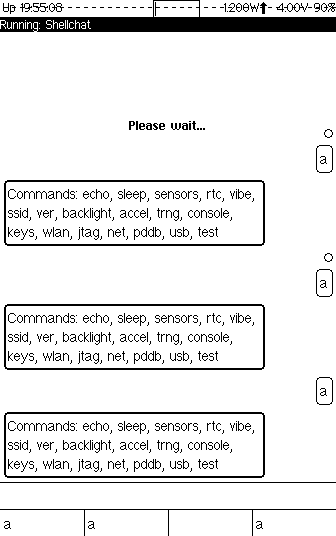
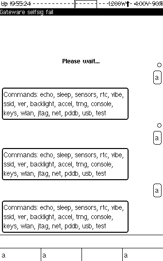
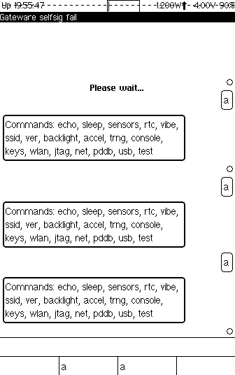
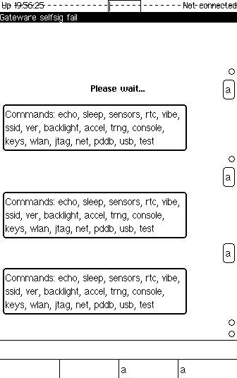
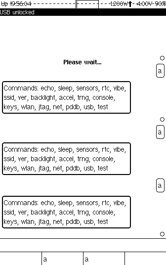

# Precursor C64

**Retrocomputing on sovereign hardware.**

```
"In 1982, you turned on a Commodore 64 and it said READY.
It did not ask for your password. It did not phone home.
It did not require a subscription. It said READY.

Forty-four years later, almost no computer says that anymore."
```

---

## What This Is

Precursor C64 is a Commodore 64 emulator that runs on [Precursor](https://precursor.dev) -- bunnie Huang's open-source, auditable secure computing handheld. It emulates the MOS 6502 CPU, VIC-II video chip, and CIA keyboard interface well enough to run text-mode programs, BASIC, and monochrome-compatible games on a 1-bit display. Games load over TCP and live in Precursor's encrypted PDDB storage.

This is not a cycle-accurate preservation project. It is a playable bridge between 1982 and now -- between the machine that taught a generation to program and the machine that lets you verify every gate in the silicon. Both machines fit in your hands. Both machines are yours.

---

## Why This Project

The Commodore 64 sold somewhere between 12.5 and 17 million units. It is the best-selling single personal computer model in history. Not because it was the most powerful -- the Apple II had better expansion, the Amiga was already on the horizon -- but because it was *accessible*. It cost $595, plugged into your television, and booted to a BASIC prompt in seconds. It said: here is a computer. It is yours. Write anything.

An entire generation learned to program on that machine. They typed `10 PRINT "HELLO"` and `20 GOTO 10` and watched the screen fill up and understood, viscerally, that they could make this thing do whatever they wanted. The C64 did not distinguish between users and programmers. There was no App Store. There was no walled garden. There was a blinking cursor and a manual.

That ethos -- *the computer belongs to you* -- did not survive the next four decades of personal computing. The machines got faster. The screens got sharper. The software got more capable. And somewhere along the way, the user stopped being the owner. Your phone has more computing power than a thousand Commodore 64s, but you cannot inspect its baseband firmware. Your laptop runs billions of transistors, but you cannot audit the management engine. The machines are not yours. They just let you use them.

Precursor is a different answer to the same question the C64 answered in 1982: *what does it mean for a computer to belong to you?* The C64 said: give them a BASIC prompt and the complete schematic. Precursor says: give them an open FPGA, source-available gateware, and a microkernel you can read. Both machines respect the user. They just operate at different layers of the stack.

Running a C64 emulator on Precursor is not nostalgia. It is a statement. The most popular personal computer ever made, running inside a computer you can verify down to the logic gates. The people's computer, reborn on sovereign hardware.

---

## Why Precursor

There is something elegant about a 100 MHz RISC-V processor emulating a 1 MHz 6502. The host is exactly 100 times faster than the guest. At 50,000 emulated cycles per frame, the math works out to roughly 20 fps with CPU cycles to spare for rendering and I/O. No tricks. No JIT compilation. No dynarec. Just a `match` statement on each opcode, running in a loop.

The display presents a genuine design problem. The C64 had 16 colors. Precursor has two: black and white. Every pixel is either on or off. The solution is a luminance threshold -- each of the C64's 16 colors has a known brightness value, and the emulator maps bright colors to white and dark colors to black. This sounds crude until you realize how many C64 games were designed around high-contrast visuals. Board games, text adventures, wireframe 3D, roguelikes -- an enormous catalog of software that looks *correct* in monochrome because it was designed for clarity, not color.

The keyboard is a surprisingly good match. The C64 had 66 keys in an 8x8 matrix scanned by the CIA chip. Precursor has a physical keyboard scanned by its own matrix. The mapping is direct: A-Z, 0-9, Space, Enter, arrows. Esc becomes RUN/STOP. The Home key (Precursor's menu key) drops back to the game selection menu. No touch screen. No virtual keyboard. Physical keys producing physical scancodes, just like 1982.

And Precursor's PDDB -- the Plausibly Deniable Database -- gives .PRG files something the C64 never had: encrypted storage. Your games live alongside your other Precursor data, protected by the same hardware encryption that protects everything else. A floppy disk in 1982 was plaintext. A Precursor in 2026 is not.

---

## How It Works

### Features

- **Full 6502 CPU** -- All 151 legal opcodes with proper flag handling, BCD arithmetic, and interrupt support
- **VIC-II Video** -- Text mode (40x25 characters) and standard bitmap mode (320x200 hi-res)
- **CIA1 Keyboard** -- 8x8 matrix scanning with Precursor key mapping
- **Bank Switching** -- BASIC ROM, KERNAL ROM, Character ROM, I/O area via $0001
- **Monochrome Rendering** -- C64 colors converted to 1-bit via luminance threshold
- **Game Storage** -- .PRG files stored in encrypted PDDB
- **TCP Import** -- Load games via `cat game.prg | nc <precursor-ip> 6464`
- **Minimal ROM** -- Built-in character font and boot stub when no C64 ROMs available

### Controls

#### Menu Mode

| Key | Action |
|-----|--------|
| Up/Down | Navigate game list |
| Enter | Select/launch |
| F4 or q | Quit app |

#### Emulator Mode

| Precursor Key | C64 Key |
|---------------|---------|
| A-Z | A-Z |
| 0-9 | 0-9 |
| Space | Space |
| Enter | Return |
| Backspace | INST/DEL |
| Arrows | Cursor keys |
| Esc | RUN/STOP |
| Menu (Home) | Back to game menu |

### Loading Games

#### Via TCP (Port 6464)

From the game menu, select "Import Game (TCP :6464)", then from your computer:

```bash
# Format: filename\n followed by .PRG binary data
(echo "othello"; cat othello.prg) | nc <precursor-ip> 6464
```

#### Using Original ROMs

For full C64 compatibility (BASIC interpreter, proper KERNAL), store ROM files in the PDDB:

- Dictionary: `c64.roms`
- Keys: `basic` (8KB), `kernal` (8KB), `chargen` (4KB)

Without original ROMs, the emulator uses a built-in minimal font and boot stub.

---

## Technical Architecture

```
src/
├── main.rs       # Xous app shell, GAM setup, emulation loop, rendering
├── cpu.rs        # MOS 6502 CPU — all legal opcodes, addressing modes
├── memory.rs     # 64KB RAM + ROM banking + I/O dispatch
├── vic.rs        # VIC-II: text mode, bitmap mode, color RAM, framebuffer
├── cia.rs        # CIA1 keyboard matrix + timers, CIA2 VIC bank select
├── keyboard.rs   # Precursor rawkeys → C64 matrix position mapping
└── loader.rs     # .PRG loading, PDDB storage, TCP import
```

### Design Decisions

**Luminance threshold** -- The C64's 16 colors mapped to black/white by brightness. Games designed around high-contrast visuals (board games, wireframe, text) render cleanly on Precursor's 1-bit display. This is not a compromise; it is a filter that reveals which software was designed for communication rather than decoration.

**Minimal built-in ROM** -- No dependency on copyrighted C64 ROMs. The emulator boots with a generated character set and stub KERNAL. Original ROMs are optional for full BASIC compatibility. This keeps the project distributable without legal encumbrance.

**50K cycles per frame** -- Balances emulation accuracy with Precursor's 100 MHz RISC-V. Sufficient for turn-based and puzzle games at roughly 20 fps. The C64 ran at 985,248 Hz (PAL) or 1,022,727 Hz (NTSC); we do not attempt full-speed emulation, but the games that work well on this display are also the games that do not need it.

**PDDB storage** -- Games stored encrypted alongside other Precursor data. TCP import avoids needing USB mass storage or SD card access. The C64 community has preserved thousands of .PRG files; loading one into Precursor takes a single `netcat` command.

**No SID audio (v1)** -- Precursor has a piezo speaker. The SID chip was one of the great sound synthesis chips of the 1980s. A piezo buzzer would dishonor it. When audio support comes, it will be worth hearing.

### Memory Map

| Address Range | Read | Write |
|--------------|------|-------|
| $0000-$00FF | Zero Page RAM | Zero Page RAM |
| $0100-$01FF | Stack RAM | Stack RAM |
| $0400-$07FF | Screen RAM | Screen RAM |
| $0800-$9FFF | RAM | RAM |
| $A000-$BFFF | BASIC ROM / RAM | RAM |
| $C000-$CFFF | RAM | RAM |
| $D000-$D3FF | VIC-II registers | VIC-II registers |
| $D400-$D7FF | SID (stub) | SID (ignored) |
| $D800-$DBFF | Color RAM | Color RAM |
| $DC00-$DCFF | CIA1 (keyboard) | CIA1 |
| $DD00-$DDFF | CIA2 (VIC bank) | CIA2 |
| $E000-$FFFF | KERNAL ROM / RAM | RAM |

### PDDB Storage Layout

| Dictionary | Key Pattern | Format |
|-----------|-------------|--------|
| c64.games | `{game_name}` | Raw .PRG binary (2-byte load addr + program) |
| c64.roms | `basic` | 8KB BASIC ROM |
| c64.roms | `kernal` | 8KB KERNAL ROM |
| c64.roms | `chargen` | 4KB Character ROM |

### What Is Not Implemented (v1)

- SID audio (returns 0, ignores writes)
- Sprites
- Raster interrupts (CIA timer IRQ works)
- Illegal/undocumented opcodes (treated as NOP)
- Smooth scrolling
- Multicolor bitmap mode
- Disk drive emulation (.D64)

### Target Games

The emulator is designed for monochrome-compatible C64 software -- programs that communicate through structure and contrast rather than color:

| Category | Examples |
|----------|----------|
| Board Games | Othello, Chess, Archon |
| Text Adventures | Zork, Hitchhiker's Guide |
| Roguelikes | Rogue, Nethack, Moria |
| Puzzle | Boulder Dash, Sokoban, Tetris |
| Strategy | Ultima I-V, Pirates!, M.U.L.E. |
| Wireframe | Elite, Mercenary, Star Wars |

---

## Building

Precursor C64 is a Xous app. It builds as part of the [xous-core](https://github.com/betrusted-io/xous-core) workspace.

### Integration

1. Clone into the apps directory:

   ```bash
   cd xous-core/apps
   git clone https://github.com/tbcolby/precursor-c64.git c64
   ```

2. Add to workspace `Cargo.toml`:

   ```toml
   "apps/c64",
   ```

3. Add to `apps/manifest.json`:

   ```json
   "c64": {
       "context_name": "C64",
       "menu_name": {
           "appmenu.c64": {
               "en": "C64 Emulator",
               "en-tts": "C 64 Emulator"
           }
       }
   }
   ```

4. Build for Renode emulator:

   ```bash
   cargo xtask renode-image c64
   ```

5. Build for hardware:

   ```bash
   cargo xtask app-image c64
   ```

---

## Screenshots

*Captured via headless Renode emulation on macOS ARM64. The Precursor display is 336x536 pixels, 1-bit monochrome.*

### First Launch

The C64 emulator's main menu. Three options: boot to BASIC, import a game over TCP, or quit. No configuration screens. No settings dialogs. Pick what you want to do and do it.



### Booting the C64

Selecting "Boot C64 (no game)" starts the emulator with the built-in minimal ROM. No original Commodore ROMs required -- the emulator ships with a generated character set and enough KERNAL stubs to reach a prompt.



### The BASIC Prompt

`READY.` -- the same word that greeted millions of users in 1982. A blinking cursor. 38911 BASIC bytes free. The machine is yours. Type `10 PRINT "HELLO"` and press RUN. Forty-four years have not changed what this feels like.



### TCP Import

The TCP import screen waits for a connection on port 6464. From any machine on the same network: `(echo "game"; cat game.prg) | nc <precursor-ip> 6464`. The C64 community has preserved thousands of .PRG files. Getting one into Precursor takes ten seconds.



### Returning to Menu

Pressing the Home key (Precursor's menu key) drops back to the game list. Any imported games appear alongside the boot option. The emulator remembers what you have loaded.



---

## Changelog

### v0.2.0

- **Fixed app registration** -- Use correct APP_NAME for GAM registration (matches manifest context_name "C64")
- **Added quit handling** -- F4 or 'q' in menu mode now exits the app

### v0.1.0

- Initial release with 6502 CPU, VIC-II text/bitmap modes, CIA keyboard, TCP game import

---

## Development
---

This app was developed using the methodology described in [xous-dev-toolkit](https://github.com/tbcolby/xous-dev-toolkit) -- an LLM-assisted approach to Precursor app development on macOS ARM64.

## Author
---

Made by Tyler Colby -- [Colby's Data Movers, LLC](https://colbysdatamovers.com)

Contact: [tyler@colbysdatamovers.com](mailto:tyler@colbysdatamovers.com) | [GitHub Issues](https://github.com/tbcolby/precursor-c64/issues)

## License
---

Licensed under the Apache License, Version 2.0.

See [LICENSE](LICENSE) for the full text.
